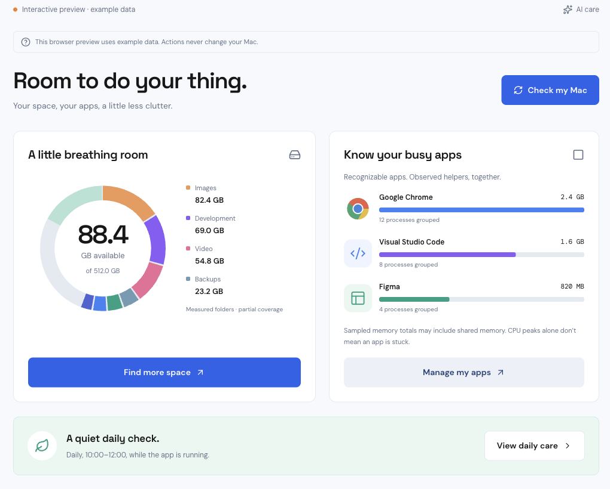
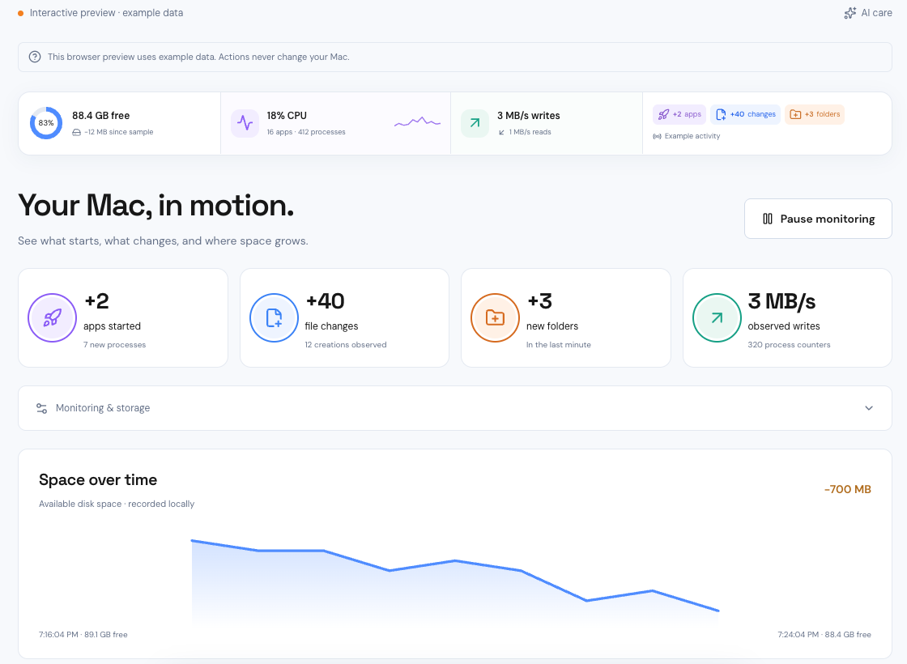

# Breathing Room

**Understand what fills your Mac. Review what can go. Keep an eye on what grows back.**

Breathing Room is a free, open-source macOS maintenance app that brings storage
exploration, app activity, and reviewable cleanup into one place. It is for anyone
who wants less disk detective work, especially developers and builders dealing
with caches, package managers, and generated project files.

[Website](https://breathing-room.chatic.ai/) ·
[Download the preview](https://breathing-room.chatic.ai/download/) ·
[GitHub Releases](https://github.com/bucabay/breathing-room-app/releases) ·
[Report an issue](https://github.com/bucabay/breathing-room-app/issues)

> **Preview for testing and development.** The universal installer supports
> Apple Silicon and Intel Macs on macOS 13+. It is Apple Development signed,
> **not Developer ID signed or notarized**; macOS may block it. Back up important
> data and review cleanup actions carefully. This is not a production-ready release.



*Cropped screenshot from an earlier browser preview, using illustrative data—not
a live scan. Some labels and layout differ from the current desktop preview.*

## What it does

| Area | What you can do |
| --- | --- |
| **Space** | Explore measured storage by category, app/tool, project, folder, or large file. Drill into folders instead of guessing what “System Data” means. |
| **Apps** | See recognizable apps with their background helpers, CPU, and memory use. Investigate busy processes without treating every spike as a problem. |
| **Cleanup Assistant** | Ask about a storage problem, inspect relevant locations, and review a native-verified cleanup plan before approving actions. |
| **Activity** | Follow free-space history, observed file/folder changes, app starts, and sampled disk I/O to investigate recurring storage growth. |
| **Menu bar** | Check live metrics and recent activity without leaving the app window open. Configure alerts for sustained CPU or disk-write activity. |
| **Daily care** | Choose a daily window and reuse approvals for exact locations and cleanup methods. New locations still wait for review. |
| **App updates** | Check for signed updates inside the app, approve installation, and choose when to restart—without manually downloading another DMG. |

Everyday, developer, builder, and creator profiles help focus relevant findings;
they are not separate paid feature tiers.



*Activity screenshot from the example-data browser preview. The numbers are
illustrative, not measured cleanup results or performance claims.*

## Install the preview

1. Visit [breathing-room.chatic.ai](https://breathing-room.chatic.ai/) and choose
   **Download now**. Sign in or create a free account with Google, GitHub, or email.
2. Alternatively, download the universal `.dmg` directly from
   [GitHub Releases](https://github.com/bucabay/breathing-room-app/releases).
   Public GitHub downloads do not require a Breathing Room account.
3. Compare the DMG's SHA-256 hash with the release's `SHA256SUMS.txt`:
   ```sh
   shasum -a 256 /path/to/Breathing-Room_VERSION_universal.dmg
   ```
4. Open the DMG, drag **Breathing Room** into **Applications**, and eject the DMG.
   Launch the Applications copy so future in-app updates can replace it.

The preview is not notarized. We do not recommend disabling Gatekeeper or other
system-wide protections to install it.

### Requirements

- **macOS 13 or later**, on Apple Silicon or Intel. Both architectures are included;
  the release has not been runtime-tested on physical Intel hardware.
- **Python 3.10+** for disk inventory and legacy cleanup scripts. Python is not
  bundled; supported locations are `/opt/homebrew/bin/python3`,
  `/usr/local/bin/python3`, and `/usr/bin/python3`.
- Internet access and sign-in for hosted agent features. Local storage/process
  tools do not require an AI Care subscription.
- macOS privacy permissions for the locations you want to inspect. Inaccessible
  locations can result in partial inventories; the app does not bypass permissions.

## How to use it

### 1. Understand your storage

Open **Space**, let the disk inventory finish, and explore its category, app/tool,
project, folder, and large-file views. Use **Scan disk** to refresh. A previous
inventory can appear while a new scan runs, so check the displayed update time.
The first scan can take several minutes and may not cover protected locations.

Choose the profiles that match how you use your Mac from the profile control in
the sidebar. Profiles focus findings; a large file is not automatically disposable.

### 2. Review a cleanup plan

Open **AI Assistant** or choose **Clean up my Mac**. Sign in when prompted, then
describe the task—for example, “Find rebuildable development caches without
touching my source files.” You can also ask about a particular location from Space.

Review each proposed action's location, method, size, explanation, and rebuild or
download cost. Select only the actions you understand and approve. The native
executor—not the model—validates and performs supported changes. Personal files,
original media, and unknown app data require separate judgment.

Read the recorded results afterward. Moving files to Trash is not the same as
immediately reclaiming disk space; review Trash yourself before emptying it.
Measured location sizes, cleanup outcomes, and available-space changes are
different numbers and should not be added together as “space recovered.”

### 3. Investigate busy apps and recurring growth

Use **Apps** to inspect CPU and memory use across an app and its helpers. Use
**Activity** to correlate storage changes with app starts, folder changes, and
observed writes. Expand **Monitoring & storage** to adjust sampling, use a lighter
folder-only mode, or pause monitoring. Configure **Activity alerts** for sustained
activity rather than reacting to every brief spike.

These are observations, not a complete audit trail. Events may be coalesced or
missed, ownership is inferred from paths, and sampled I/O does not prove which
process wrote a particular file. High usage alone is not proof that an app is stuck.

Sort Apps by **Memory** or **CPU**, search for an app, and expand it to see helpers.
App CPU uses 100% for one core and can exceed 100%; summed process memory can
include shared pages. **Quit app** requests a graceful quit. Ending background
processes or using **Force quit group** is different and can lose unsaved work;
those actions require confirmation and protected processes are excluded.

### 4. Set up daily care, if you want it

Open **Daily care**, choose a start time and window, review your approved locations,
and save preferences. You can enable keeping the app in the menu bar when its
main window closes. Scheduled care cleans only exact locations and methods you
previously approved; newly discovered locations wait for review.

Breathing Room must remain running. It does not wake your Mac, run after quitting,
or enable launch-at-login automatically. Busy or low-battery Macs can run later.

### 5. Install future updates inside the app

Choose **App updates** in the footer. Checks also run automatically, but downloading
and installing an available update require approval. Signatures are verified
before installation; **Restart now** is a separate action. Installation is blocked
while an agent or maintenance operation is active.

The first preview establishes the signed update feed. A full upgrade from this
preview to a later version still needs cross-version release validation. Updater
signatures are separate from Apple's Developer ID signing and notarization.

## Free app and optional AI Care

The core app is free to download and use. Local storage views, inspection/manual
tools, and CPU/memory monitoring do not require an AI Care subscription.
Agent-assisted workflows require an authenticated hosted service connection.

**AI Care is optional: $5 USD/month or $50 USD/year.** It is the ongoing-care offer
for scheduled approved cleanup, new cleanup opportunities, and AI-assisted
investigation. There is no separate app purchase, and no unlimited-AI promise.
See the [website](https://breathing-room.chatic.ai/#pricing) for the current offer.

The website's download registration and subscription checkout use the same
Breathing Room accounts. Use the same sign-in method in the desktop app. The
website records registrations and download starts; release/update email consent
is a separate, optional opt-in. Public releases and in-app updates are not gated
by website registration.

## Privacy and safety boundaries

- Disk inspection and cleanup run on your Mac. Inventory, activity history,
  approvals, and agent run records are stored locally under
  `~/Library/Application Support/app.breathingroom.mac/`.
- AI-assisted requests use the configured hosted service and can include your
  question and relevant tool output, including file paths and storage information.
  This is **not** an entirely offline AI app.
- There is no blanket authorization to delete new data. Approvals are tied to
  exact methods and locations; an AI explanation is not execution authority.
- Unknown data and original files are not automatically safe because they are
  large. Cache cleanup can require rebuilding or downloading files again.
- The direct-distribution build is not App Sandbox restricted. macOS privacy
  permissions still apply, and the app does not guarantee a speedup or space savings.

## Build from source

Use macOS with Node.js 22.13+, pnpm, a current stable Rust toolchain, Cargo,
Xcode Command Line Tools, and Python 3.10+ for the scripting workflows.

```sh
git clone https://github.com/bucabay/breathing-room-app.git
cd breathing-room-app
pnpm install --frozen-lockfile

# Browser preview: example data only; no disk inspection or cleanup.
pnpm dev

# Native development app: real local data and macOS permission boundaries.
pnpm exec tauri dev --config src-tauri/tauri.direct.conf.json
```

The browser preview runs at `http://127.0.0.1:1430`. It is not the desktop app.

Build a local app bundle without installing over your working copy:

```sh
pnpm exec tauri build --debug --bundles app --config src-tauri/tauri.direct.conf.json
```

**Installation side effect:** the `pnpm tauri build` wrapper and
`pnpm desktop:build` install/relaunch the resulting app in `/Applications`.
Use the direct `pnpm exec tauri` commands above when you do not want that behavior.

### Tests and read-only CLI

```sh
pnpm build
pnpm test
cargo test --manifest-path src-tauri/Cargo.toml
PYTHONDONTWRITEBYTECODE=1 python3 -m unittest discover -s tests -p '*_test.py'

# Bounded, read-only inspection commands; these do not start cleanup.
cargo run --manifest-path src-tauri/Cargo.toml -- scan "$HOME/Downloads"
cargo run --manifest-path src-tauri/Cargo.toml -- apps
```

For universal builds, signing, release checks, and publishing the update feed,
see [RELEASING.md](RELEASING.md). Apple signing/notarization credentials and the
updater private key must stay outside Git. Never regenerate the updater key
casually: installed apps trust the original public key.

### Repository map

| Path | Purpose |
| --- | --- |
| `src/` | React UI, storage views, assistant/review flows, and app-side state |
| `src-tauri/src/` | Native inspection, monitoring, approval/execution, local persistence, and updater |
| `scripts/cleanup/` | Python inventory and supported cleanup handlers/catalog |
| `tests/` and `src-tauri/tests/` | UI/model, scripting, and release-signature tests |
| `updates/preview.json` | Public signed-artifact metadata for the preview update channel |

This is the **desktop app repository**. The marketing website, hosted AI/billing
backend, hosted dashboard, internal business docs, and signing credentials are not
included. Open-source licensing does not grant free hosted service access.
The default API origin/model are public client configuration in
`src/agent-config.json`; a compatible service origin can be selected with
`BREATHING_ROOM_API_URL` in the app process environment.

## Feedback and contributions

[Open an issue](https://github.com/bucabay/breathing-room-app/issues) with the app
version, macOS version, architecture, reproduction steps, and expected/actual
behavior. Redact names, private paths, credentials, and file contents from logs or
screenshots. Do not post security credentials in a public issue.

Before proposing a change, run the relevant tests. Cleanup changes must preserve
exact-path verification, explicit approval, and separation of inspection from
execution. Do not add broad deletion authority to improve a demo result.

## License and attribution

[Apache License 2.0](LICENSE), with attribution in [NOTICE](NOTICE). Redistributors
must preserve applicable license and notice requirements, mark modified files,
and supply the license. A visible in-app credit is not required.

The UI foundation includes Seal-derived MIT-licensed code; its original notice is
preserved in [THIRD_PARTY_LICENSES/Seal-MIT.txt](THIRD_PARTY_LICENSES/Seal-MIT.txt).
Other dependencies retain their respective licenses. The license does not grant
trademark rights or imply official endorsement.
